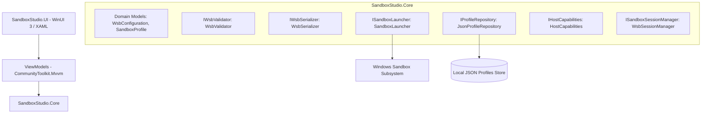
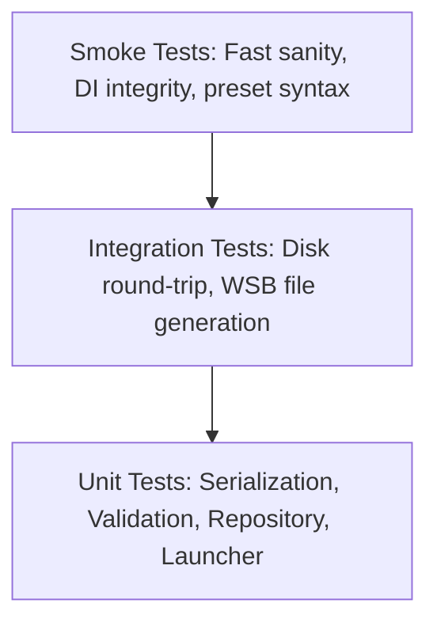

# System Architecture

`SandboxStudio` is engineered using a clean, layered architectural model separating UI presentation, domain logic, persistence, and operating system orchestration.

## Layers & Components

### 1. `SandboxStudio.Core` (Target: `net10.0`)
Pure domain library with zero UI dependencies:
* **`Models`**: Strongly-typed C# models mapping 1:1 to Microsoft Windows Sandbox XML schema (`<Configuration>`, `<VGpu>`, `<Networking>`, `<MappedFolders>`, `<LogonCommand>`).
* **`Serialization`**: High-performance XML serializer emitting clean, compliant `.wsb` documents without spurious schema namespaces (`xmlns:xsi`, `xmlns:xsd`).
* **`Validation`**: Enforces system constraints (memory bounds $\ge 256$ MB, command length limits, valid path syntax, read-only flags).
* **`Storage`**: Thread-safe atomic file persistence for user-defined profiles and built-in curated presets.
* **`Execution`**: Validates configuration, then launches through the `wsb` CLI when supported (capturing the sandbox ID) or materializes a transient `.wsb` file for the host Windows Sandbox process.
* **`Capabilities`**: Computes effective per-feature availability from host OS build and Windows Sandbox policy registry values, and reports overall Sandbox host status.
* **`Sessions`**: Discovers and controls live sandbox sessions through the `wsb` CLI (Windows 11 24H2+): starts sessions from inline configuration XML, lists them from `--raw` JSON output, executes commands inside them (exit code only — output cannot be captured), reports their IP addresses, shares host folders into them, and stops or connects to them by sandbox ID.

### 2. `SandboxStudio.UI` (Target: `net10.0-windows10.0.19041.0`)
Presentation layer powered by Windows App SDK and WinUI 3:
* **Fluent Design**: Native Mica backdrop, smooth transitions, reactive Light/Dark system theme synchronization.
* **MVVM**: Fully decoupled view-models utilizing source-generated observables and relay commands.
* **Dependency Injection**: Composed via `Microsoft.Extensions.Hosting`.

## Testing Pyramid

* **Unit Tests (`tests/SandboxStudio.Tests.Unit`)**: Behavior-focused assertions using FluentAssertions and Moq.
* **Integration Tests (`tests/SandboxStudio.Tests.Integration`)**: Disk persistence and round-trip fidelity against real file systems.
* **Smoke Tests (`tests/SandboxStudio.Tests.Smoke`)**: Fast sanity verification of container registration and schema contracts.
