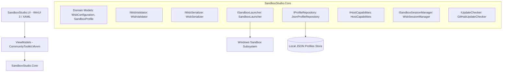
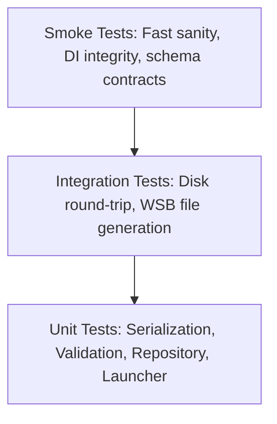

# System Architecture

`SandboxStudio` is engineered using a clean, layered architectural model separating UI presentation, domain logic, persistence, and operating system orchestration.

## Layers & Components

### 1. `SandboxStudio.Core` (Target: `net10.0`)
Pure domain library with zero UI dependencies:
* **`Models`**: Strongly-typed C# models mapping 1:1 to Microsoft Windows Sandbox XML schema (`<Configuration>`, `<VGpu>`, `<Networking>`, `<MappedFolders>`, `<LogonCommand>`).
* **`Serialization`**: High-performance XML serializer emitting clean, compliant `.wsb` documents without spurious schema namespaces (`xmlns:xsi`, `xmlns:xsd`).
* **`Validation`**: Enforces system constraints (memory bounds $\ge 256$ MB, command length limits, valid path syntax, read-only flags).
* **`Storage`**: Thread-safe atomic file persistence for user-defined profiles. The app ships no pre-existing profiles: Windows Sandbox itself has no profile store — `.wsb` files are loose XML documents the user keeps wherever they like — so the library starts empty and is populated only by the user (create, duplicate, or import).
* **`Execution`**: Validates configuration, then launches through the `wsb` CLI when supported (capturing the sandbox ID) or materializes a transient `.wsb` file under `%USERPROFILE%/.sandboxstudio/Runs` for the host Windows Sandbox process. `SharedDataPaths` (in `Storage`) owns that root: everything Windows Sandbox itself reads lives outside AppData, which Sandbox cannot map and which the Store build's AppData redirection hides from other processes.
* **`Capabilities`**: Computes effective per-feature availability from host OS build and Windows Sandbox policy registry values, and reports overall Sandbox host status.
* **`Sessions`**: Discovers and controls live sandbox sessions through the `wsb` CLI (Windows 11 24H2+): starts sessions from inline configuration XML, lists them from `--raw` JSON output, executes commands inside them (exit code only — output cannot be captured), reports their IP addresses, shares host folders into them, and stops or connects to them by sandbox ID.
* **`Scripts`**: Packages multi-line logon commands into `.cmd` files under a per-profile directory `%USERPROFILE%/.sandboxstudio/Scripts/<profile-id>` (not AppData: Windows Sandbox fails to start when a mapped host folder lives under `%APPDATA%` or `%LOCALAPPDATA%`, so the validator warns about such mappings), delivered to the sandbox through a managed read-only mapped folder at `C:\SandboxStudio\Scripts` — Microsoft's recommended pattern for multi-step setup. Only the profile's own directory is mounted, so a sandbox never sees another profile's scripts; profiles saved with the older shared layout or under the old `%LocalAppData%/SandboxStudio/Scripts` root are migrated on load.
* **`Updates`**: Discovery-only release check — `GitHubUpdateChecker` compares the assembly informational version against the repository's latest GitHub release tag and reports an HTTPS release URL for the UI to surface. It never downloads or installs anything; only HTTPS release links are propagated.
* **`Localization`**: `MessageKeys` constants identifying user-facing text composed in Core; records carry optional `MessageKey`/`ErrorKey` + format args alongside their English fallback so hosts can localize capability reasons, policy overrides, validation messages, and CLI failures.

### 2. `SandboxStudio.UI` (Target: `net10.0-windows10.0.19041.0`)
Presentation layer powered by Windows App SDK and WinUI 3:
* **Fluent Design**: Native Mica backdrop, smooth transitions, reactive Light/Dark system theme synchronization.
* **MVVM**: Fully decoupled view-models utilizing source-generated observables and relay commands.
* **Dependency Injection**: Composed with a plain `Microsoft.Extensions.DependencyInjection` container (no generic host — the app runs no hosted services).
* **Two distributions, one project**: `WindowsPackageType=None` (default) publishes the portable single-file exe; `WindowsPackageType=MSIX` builds the Microsoft Store package from `Package.appxmanifest`. `AppDistribution` tells them apart at runtime (package identity): the Store build skips the GitHub update check and receives `.wsb` files through file activation, while the portable exe takes them as a command-line argument.

## Distribution and signing

| Channel | Build | Signing | Updates |
|---|---|---|---|
| GitHub Releases | `scripts/publish.ps1` → single-file exe (x64) | Authenticode via SignPath Foundation, after manual approval | `GitHubUpdateChecker` banner |
| Microsoft Store | `scripts/package-msix.ps1` → `.msixbundle` (x64 + arm64) | Microsoft, at Store ingestion | Store |

Both come from one run of `.github/workflows/release.yml`; CI also packages both on every pull request. See [docs/RELEASING.md](docs/RELEASING.md).

## Testing Pyramid

* **Unit Tests (`tests/SandboxStudio.Tests.Unit`)**: Behavior-focused assertions using FluentAssertions and Moq.
* **Integration Tests (`tests/SandboxStudio.Tests.Integration`)**: Disk persistence and round-trip fidelity against real file systems.
* **Smoke Tests (`tests/SandboxStudio.Tests.Smoke`)**: Fast sanity verification of container registration and schema contracts.
