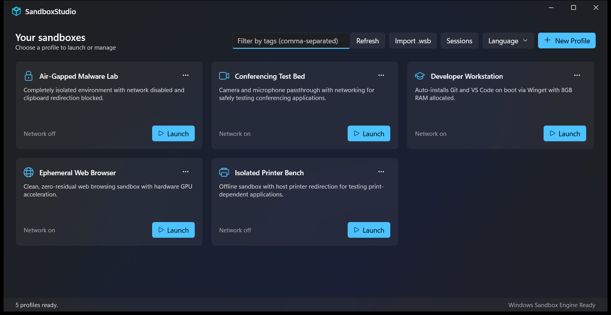

<p align="center">
  
</p>

<h1 align="center">SandboxStudio</h1>

<p align="center">
  <strong>Create, launch and manage Windows Sandbox profiles from one fast, native app.</strong>
</p>

<p align="center">
  <a href="https://github.com/PAumedes/SandboxStudio/actions/workflows/ci.yml"></a>
  <a href="https://github.com/PAumedes/SandboxStudio/releases/latest"></a>
  
  
  <a href="LICENSE"></a>
</p>

<p align="center">
  
</p>

[Windows Sandbox](https://learn.microsoft.com/windows/security/application-security/application-isolation/windows-sandbox/)
gives you a disposable Windows desktop in seconds, but configuring it means
hand-editing `.wsb` XML files. SandboxStudio turns those files into a library of
profiles you can edit with real controls, validate before launch, and start with
one click — then keep an eye on the sandboxes that are running.

## Install

| | Microsoft Store | Portable exe |
|---|---|---|
| **Get it** | Coming soon | [Latest release](https://github.com/PAumedes/SandboxStudio/releases/latest) › `SandboxStudio-<version>-win-x64.exe` |
| **Updates** | Automatic | In-app "Update available" banner |
| **Architectures** | x64, arm64 | x64 |
| **Install** | One click, no admin | None — download and run one file |

**Requirements:** Windows 10 1903 or later (Windows 11 recommended) on Pro,
Enterprise or Education, with hardware virtualization and the Windows Sandbox
feature enabled. To enable it, run this in an elevated PowerShell and restart:

```powershell
Enable-WindowsOptionalFeature -Online -FeatureName Containers-DisposableClientVM -All
```

The portable exe bundles the .NET runtime and the Windows App SDK; its first
launch of each version takes a few extra seconds while it unpacks. Verify a
download against the `.sha256` file published next to it.

## Features

- **Profile library.** Curated presets adapted to your Windows build, plus your
  own profiles, with tags and a tag filter. Duplicate, export and delete from
  each card's menu.
- **Every `.wsb` setting, with guardrails.** Networking, vGPU, memory,
  microphone and camera, protected client, clipboard and printer sharing, mapped
  folders and the startup command. New mapped folders are read-only; writable ones
  need an explicit acknowledgement, and launching them asks again.
- **Validation before launch.** Missing or duplicate host folders, folders under
  AppData that Windows Sandbox cannot map, environment variables your Windows
  build cannot expand, memory below the recommended minimum, and host policies
  that override a profile's settings.
- **Multi-step startup scripts.** Script mode packages each line of the startup
  command into a `.cmd` delivered through a managed, read-only mapped folder —
  Microsoft's recommended pattern — and each profile only sees its own script.
- **Import and export `.wsb`.** Import from the toolbar or open a `.wsb` file
  with SandboxStudio; export any profile back to a `.wsb` file.
- **Live sessions** (Windows 11 24H2+). See running sandboxes, connect, stop,
  run commands inside them, read their IP address and share a host folder into
  them through the `wsb` CLI.
- **Native and localized.** WinUI 3 with Mica, following the Windows light or
  dark theme, in English and Spanish.

Your profiles never leave your computer: SandboxStudio has no telemetry and no
account. See the [privacy policy](PRIVACY.md).

## Build from source

Prerequisites: Windows 10/11 x64, the [.NET 10 SDK](https://dotnet.microsoft.com/download/dotnet/10.0),
and Visual Studio 2022 Build Tools (or Visual Studio) with the Windows App SDK
C# workload. The full IDE is only needed for F5 debugging.

```powershell
dotnet build SandboxStudio.sln -c Release
dotnet test SandboxStudio.sln -c Release --no-build
```

Run the Debug x64 build:

```powershell
dotnet build .\SandboxStudio.sln -c Debug -p:Platform=x64
& .\src\SandboxStudio.UI\bin\x64\Debug\net10.0-windows10.0.19041.0\win-x64\SandboxStudio.UI.exe
```

The dashboard opens without Windows Sandbox enabled; only **Launch** needs it.
Package the distributions locally with `scripts\publish.ps1` (portable exe) and
`scripts\package-msix.ps1` (Store bundle); [docs/RELEASING.md](docs/RELEASING.md)
covers signing and Store submission.

```text
SandboxStudio/
├── src/
│   ├── SandboxStudio.Core/   # Models, validation, .wsb serialization, storage, launcher, wsb CLI
│   └── SandboxStudio.UI/     # WinUI 3 app (MVVM)
├── tests/                    # Unit, integration and smoke tests (xUnit)
├── scripts/                  # publish, package-msix, release
└── docs/                     # Release guide, images
```

Read [ARCHITECTURE.md](ARCHITECTURE.md) for the design and
[ROADMAP.md](ROADMAP.md) for what is done and what is next.

## Contributing

Bug reports, ideas and pull requests are welcome — start with
[CONTRIBUTING.md](CONTRIBUTING.md) and the [code of conduct](CODE_OF_CONDUCT.md).
Report security problems privately as described in [SECURITY.md](SECURITY.md).
Notable changes are listed in the [changelog](CHANGELOG.md).

## Code signing policy

Free code signing provided by [SignPath.io](https://about.signpath.io), certificate by [SignPath Foundation](https://signpath.org).

Release executables are built from this repository by the
[Release workflow](.github/workflows/release.yml) and signed only after a manual
approval. The Microsoft Store package is signed by Microsoft.

| Role | Members |
|---|---|
| Committers and reviewers | [Members team](https://github.com/PAumedes/SandboxStudio/graphs/contributors) — currently [@PAumedes](https://github.com/PAumedes) |
| Approvers | [Owners](https://github.com/PAumedes) — [@PAumedes](https://github.com/PAumedes) |

**Privacy:** this program will not transfer any information to other networked
systems unless specifically requested by the user or the person installing or
operating it, with one exception: the portable exe checks the GitHub Releases API
for a newer version at startup. See the [privacy policy](PRIVACY.md).

## License

[MIT](LICENSE) © SandboxStudio Contributors
